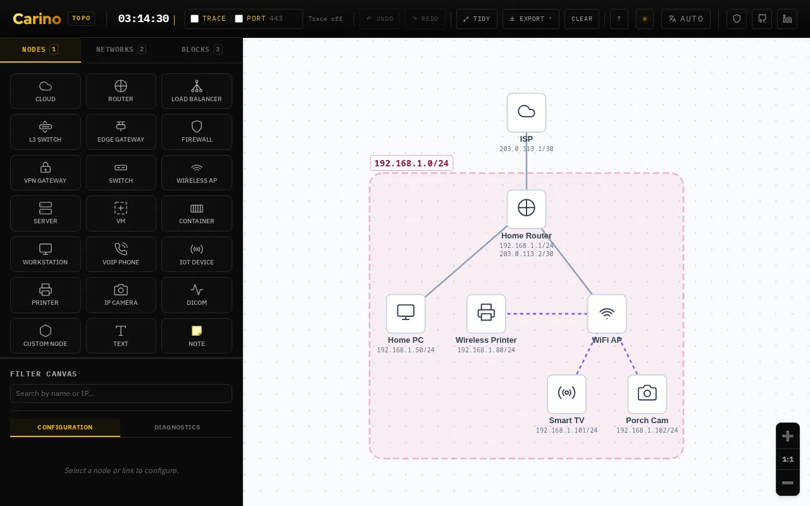

# Topo

A network register you draw. Put down the devices, their addresses and the cables between them; Topo checks the network as you go (address conflicts, switching loops, gateways and DNS servers a device cannot reach) and turns it into a printable site report.

**[Open it →](https://topo.carino.systems/)** — runs in your browser, nothing to install, no account.

## What it is for

Most small networks (a clinic, an imaging centre, an office, a home) were never written down. Topo is where they get written down once, properly, by the person who knows them:

- **Record** what is there: every device, address, subnet, cable, port, rack and Wi-Fi network, in one document.
- **Check** it while you draw, so a wrong gateway or a duplicate address is found on the map rather than on site.
- **Hand it over** as a site report, cable and asset labels, a spreadsheet or a file someone else can open.

It is for the technician documenting a site and, through the simple view, for staff who are not technicians and only need to say what is plugged into what.

## Features at a glance

Every feature is described in full in **[docs/FEATURES.md](docs/FEATURES.md)**.

- **Three views of one document.** Simple (`#simple`, `#imagenology`) for non-technicians, in five languages; the Full editor (`#advanced`) with every field; and Setup (`#setup`), which draws a network from a count of devices. Switching loses nothing.
- **The register.** About twenty device types with interfaces, MACs and asset details; subnets as objects that devices inherit gateway and DNS from, with Renumber; groups for buildings, floors, rooms and racks; VMs and containers on their hosts; Wi-Fi networks, radios and links; named ports with labels, untagged and tagged VLANs and PoE, PoE budgets and draws; cables with tag, colour, length and run.
- **Rack view.** Front and rear elevations numbered as the rails are, with each device's ports, cables routed through the manager, drag-and-drop placing, and a patch schedule.
- **Checks.** Duplicate IPs and MACs, unreachable gateways and DNS, switching loops, mismatched cable ends, rack overlaps, and Wi-Fi faults (bands, channels, overlap, weak security, weak signal). One set of findings feeds the map, the Findings tab and the report; a finding can be accepted with a reason. Trace shows what a device can reach, one VLAN at a time. Locate shows where a device is plugged in: NIC, cable, switch port and jack, rack units and room, with every unrecorded link named rather than guessed, and a print sheet to take on site; the simple views say it in one plain sentence.
- **Many devices at once.** Multi-select, Change all with a preview of what the checks would find afterwards, a sortable editable Table, a search language (`ip:`, `vlan:`, `group:`, `has:finding`…) with saved searches kept in the network, Add devices by pattern, reusable Blocks, Tidy, and undo per action.
- **Spreadsheets in and out.** CSV/TSV export of every sheet (saved searches included) that round-trips unchanged; import by heading or by what the values look like; paste ARP tables, DHCP leases and network scans (nmap, arp-scan, netdiscover, Advanced/Angry IP Scanner exports) from common vendors. Every import is reviewed before it applies. Columns of your own (text, number, date, yes/no) on the Devices table, carried in the file and the spreadsheet; an unknown heading in an imported sheet can become one.
- **Output.** A printable site report: a one-page summary in plain words for the client (is the network fine, what needs attention and why, what there is), the technical details (findings, inventory, counts by vendor, model and firmware, rack elevations, patch schedules, port maps, Wi-Fi, saved searches as tables of their own, changes, diagram, each section with a tick of its own), or both; 62 × 29 mm labels with QR asset links, a Locate sheet of where each selected device is plugged in, PNG/WEBP/SVG, and a hand-off to [Netplan](https://netplan.carino.systems/).
- **Keeping your work.** Autosaves in this browser; `.json` back-ups and binders; changes counted since the last back-up; older files upgraded, newer ones opened read-only.
- **Problems, providers and a server.** Report a problem routed to the provider who covers it; provider mode, Record visit and a copy back that waits for the network's owner to review (**Visits waiting**: apply or reject the changes, judge the visit). A Topo server you host keeps networks in step between the client and their providers, end-to-end encrypted, and the desktop app can be that server or a client of one (**Connect to a Topo server**). See [docs/SERVER.md](docs/SERVER.md).
- **Answer checks and alarms (the desktop app).** A desktop app someone turns into a monitor (Settings, Monitoring, **Monitor from this PC**, off as shipped) asks each device marked to be checked "are you answering?" (ping, TCP, HTTP(S) with the certificate's end date, DNS, SMTP's greeting, DICOM C-ECHO, NTP with the clock's offset, RTSP and SIP OPTIONS, an HL7 MLLP connect, IPP's printer state, IMAP and POP greetings), shows a dot on the map, and works out root cause ("Router R1 and 12 devices behind it"). An outage becomes an issue in Problems that stays open until someone acknowledges it, reports it or marks it expected; **Show alarms on this PC** (off as shipped) raises a full-screen card and a notification. On a Topo server an owner makes such a PC the site's **monitor**, which keeps reporting with no one signed in, and every signed-in page sees its status and issues; a provider can **Monitor during this visit** and the figures go into their visit report.
- **Statistics and reports.** Response times and availability collected while checks run, kept 360 days (or Off, which keeps nothing): availability against a target with the measured coverage beside every figure, response-time charts with their tables, outages with MTTR and MTBF, a provider report, and CSV, through the print preview.
- **This computer, the screen lock and Setup.** The desktop app reads the PC it runs on (its interfaces, addresses, gateway and DNS servers) and adds it to the map through the Import… review. The screen locks after 30 minutes without use (Settings, **Screen lock** tab), saving first; a PIN or the server sign-in unlocks it; it hides an unattended screen and is not encryption. The first plain start opens **Setup**: a few skippable questions (the look, the view, where networks are kept, the lock, in the app This computer and monitoring, then how to begin); in the app it also connects to a Topo server or makes this PC the server, step by step, signing in at the end; Settings, **Run the setup again**.

### File format

A back-up is `topo_<organization>_<site>_<date>.json` and a binder `topo_<organization>_<date>.json` (or `topo_networks_<date>.json`). Both are JSON saved as `application/vnd.carino.topo+json`, and both open with `"$schema": "https://topo.carino.systems/schema/topo-v19.json"` before the envelope (`kind`, `version`, then `name` and `doc`, or `exported` and `sites`). The schema is [`schema/topo-v19.json`](schema/topo-v19.json), field by field, and [docs/FORMAT.md](docs/FORMAT.md) describes every key, the ids, the log, the merge rules and the migrations from every older version. Readers ignore `$schema`, and nothing fetches it.
- **Private by design.** The website and the offline zip have no server and upload nothing; a Topo server you host yourself (above) receives only what each browser encrypted. The network is kept out of the URL, share links are passphrase-locked (AES-GCM), and there is no field for a Wi-Fi key.
- **Scale.** A 300-device site redraws, checks and previews a bulk change in tens of milliseconds, held to a budget by a test.

## What it is not

- **Not a scanner.** It knows what you draw, type or paste. It never discovers anything (no sweeps, ARP, SNMP, LLDP or port scans) and never reads another device's configuration. The one way it touches the network is the answer check above: only from a desktop app someone turned into a monitor, only for devices and services already documented and marked to be checked, one fixed request each, keeping only whether it answered, how long it took and the reply's status code. Nothing logs in, sends a message or prints. The website and the offline zip never probe. Use [Ping](https://ping.carino.systems/) for ad-hoc live checks.
- **Not a paging service.** Alarms are on screen only: a card and a notification on the PCs that ask for them, a banner on signed-in pages. No email, call, SMS or push for an outage.
- **VLANs are checked and traced.** Ports, interfaces and subnets carry untagged and tagged VLANs (trunks) and PoE, shown in the editor, the table and the report. The checks find a VLAN that does not reach its gateway over the switches, the two ends of a cable that disagree on their VLANs, and an access VLAN no subnet has; an end with nothing recorded carries every VLAN. The Trace follows one VLAN at a time (its VLAN tick, on by default), and unticked walks every VLAN. PoE is checked: a powered device on a port that gives none, a draw more than the port gives, and a switch over its PoE budget.
- **Not a full DCIM.** Patch panels and wall jacks are written on the cable's run rather than drawn; power, weight and device models are not drawn.
- **Not a password store.** It warns when notes look like they hold a password, and has nowhere to keep a Wi-Fi passphrase.

## Development

Static files, no build step. `tests/run.sh` runs every suite in headless Chromium; see [tests/README.md](tests/README.md).

**Related tools:** [Hardware](https://hardware.carino.systems/) · [Netplan](https://netplan.carino.systems/) · [Ping](https://ping.carino.systems/)

## Offline and desktop builds

Topo also comes as desktop apps (Windows, macOS and Linux, on x64 and Arm) and as a plain offline zip, from [GitHub Releases](https://github.com/MiguelCarino/Topo/releases). The `Builds` workflow (`.github/workflows/builds.yml`) makes all of them into one **draft** release; nothing is public until the owner publishes it.

- **Zip:** unzip, open `index.html` in a desktop browser. It is the website's files byte for byte.
- **Desktop apps** ([Tauri v2](https://v2.tauri.app/), the system webview): `.dmg` for macOS, `.msi` and `-setup.exe` for Windows, `.deb`, `.rpm` and `.AppImage` for Linux. They run the same files as the website; only the staged copy's CSP adds the app's IPC origins (`ipc:`, `http://ipc.localhost`).
- **Unsigned.** macOS: the app is signed ad hoc; approve it under System Settings > Privacy & Security > Open Anyway, or run `xattr -dr com.apple.quarantine /Applications/Topo.app`. Windows: SmartScreen shows "More info > Run anyway"; WebView2 ships inside the installers (Tauri's `offlineInstaller` mode), so they install with no internet, as on an intranet. Linux: the AppImage needs FUSE, or `--appimage-extract-and-run`.
- **Where work is kept.** The app keeps its library in its own data folder, separate from the website's. Uninstalling it (or the Windows uninstaller's "delete app data") can delete it: Export first. A network that has not been kept is lost when the app quits, because the live document lives in the page's history: keep it before quitting.
- **Only the desktop app** checks devices, raises the alarm card (`desktop/alarm.html`, its own window), reads This computer, connects to a Topo server through its own Rust client, and can run the server itself. Monitoring offers the system tray and Open Topo at sign-in, so it goes on with the window closed. What was tested on which system, and what still needs a real desktop session or Windows and macOS, is listed in [docs/SCOPE.md](docs/SCOPE.md) section 7, "Open items".
- The app opens on a short intro animation (`desktop/intro.html`), then the editor. Saved files go to the Downloads folder. On macOS, Print opens the report in the default browser, which prints it. Share links and label QR codes open the website; the app cannot take links yet.

Building locally (Rust, Node and the Tauri system packages; on Linux `webkit2gtk-4.1` and `libsoup-3.0` with their `-devel` packages):

    desktop/stage.sh desktop/dist --desktop
    cd desktop
    npx @tauri-apps/cli@2.12.4 icon ../logo.svg -o src-tauri/icons
    npx @tauri-apps/cli@2.12.4 build

The icons are generated from `logo.svg` and never committed; `cargo check` needs them too, so stage and make the icons first. `desktop/stage.sh <dir>` alone makes the zip's folder. `node tests/stage-check.mjs` checks the stage script.

## Licensing

**Mine — GNU Affero General Public License v3.0 or later.** Everything in this
repository *except* the paths listed below. Copyright © 2026 Miguel Carino.
Full terms in [LICENSE](LICENSE).

**Not mine.** The files below are third-party works redistributed here. This
project's licence does not cover them and could not: they are not mine to
relicense. Each keeps its own terms, and each carries its own notice.

| Path | What it is | Licence | Notice |
| --- | --- | --- | --- |
| [`fonts/`](fonts/) | IBM Plex Mono, IBM Plex Sans, Red Hat Display | SIL OFL 1.1 | [`fonts/OFL.txt`](fonts/OFL.txt) |
| [`vendor/`](vendor/) | third-party JavaScript | per package — see the notice | [`vendor/README.md`](vendor/README.md) |

Those files travel with any fork, mirror or repackaging of this repository, and
their notices must travel with them.

**Built in, not stored here.** The desktop app and topo-server are compiled
from packages downloaded at build time (Cargo.lock and go.sum pin them). None
of them is in this repository, but the built app contains them, so the app
carries their licences:

| Built into | From | Licences | Notice |
| --- | --- | --- | --- |
| the desktop app | about 420 Rust crates ([`desktop/src-tauri/Cargo.lock`](desktop/src-tauri/Cargo.lock)): Tauri; ureq, rustls, ring and webpki-roots for Connect to a Topo server; rusqlite with SQLite compiled in for monitoring statistics; p256 for the monitor's encryption | mostly MIT or Apache-2.0; also ISC, BSD-3-Clause, Zlib, MPL-2.0, Unicode-3.0, CDLA-Permissive-2.0 (webpki-roots' list of certificate authorities); SQLite is public domain | [`desktop/THIRD-PARTY.txt`](desktop/THIRD-PARTY.txt), copied into the app |
| topo-server (inside the app, and on its own) | 8 Go modules ([`server/go.mod`](server/go.mod)): modernc.org/sqlite and the modules it needs, golang.org/x/sys | BSD-3-Clause, MIT | the same file |

`desktop/THIRD-PARTY.txt` lists every crate and module with its licence and
each distinct licence text once. It is made by `node desktop/third-party.mjs`
(offline, from the downloaded crates and modules); run it again after a change
to `Cargo.lock` or `go.sum`, and `node desktop/third-party.mjs --check` says
whether it is current. MPL-2.0 covers a few crates Tauri uses (cssparser,
selectors and the like); they are used unchanged, and their source is at the
addresses the file gives.
