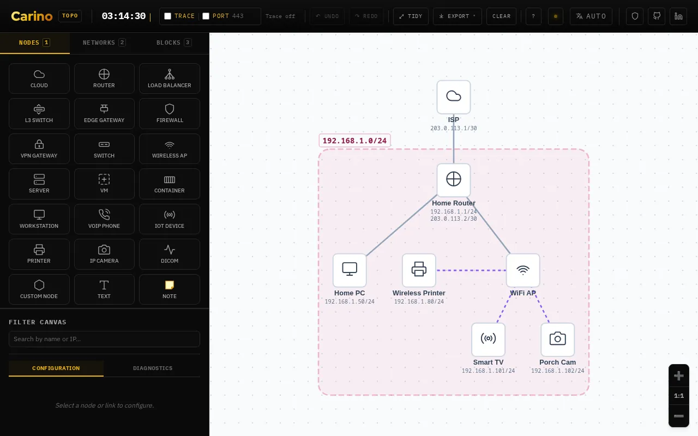

# Topo

A network register you draw. Put down the devices, their addresses and the cables between them; Topo checks the network as you go (address conflicts, switching loops, gateways and DNS servers a device cannot reach) and turns it into a printable site report.

**[Open it →](https://topo.carino.systems/)** — runs in your browser, nothing to install, no account.

## What it is for

Most small networks (a clinic, an imaging centre, an office, a home) were never written down. Topo is where they get written down once, properly, by the person who knows them:

- **Record** what is there: every device, address, subnet, cable, port, rack and Wi-Fi network, in one document.
- **Check** it while you draw, so a wrong gateway or a duplicate address is found on the map rather than on site.
- **Hand it over** as a site report, cable and asset labels, a spreadsheet or a file someone else can open.

It is for the technician documenting a site and, through the simple view, for staff who are not technicians and only need to say what is plugged into what.

## Features at a glance

Every feature is described in full in **[docs/FEATURES.md](docs/FEATURES.md)**.

- **Three views of one document.** Simple (`#simple`, `#imagenology`) for non-technicians, in five languages; the Full editor (`#advanced`) with every field; and Setup (`#setup`), which draws a network from a count of devices. Switching loses nothing.
- **The register.** About twenty device types with interfaces, MACs and asset details; subnets as objects that devices inherit gateway and DNS from, with Renumber; groups for buildings, floors, rooms and racks; VMs and containers on their hosts; Wi-Fi networks, radios and links; named ports with labels and VLANs; cables with tag, colour, length and run.
- **Rack view.** Front and rear elevations numbered as the rails are, with each device's ports, cables routed through the manager, drag-and-drop placing, and a patch schedule.
- **Checks.** Duplicate IPs and MACs, unreachable gateways and DNS, switching loops, mismatched cable ends, rack overlaps, and Wi-Fi faults (bands, channels, overlap, weak security, weak signal). One set of findings feeds the map, the Findings tab and the report; a finding can be accepted with a reason. Trace shows what a device can reach.
- **Many devices at once.** Multi-select, Change all with a preview of what the checks would find afterwards, a sortable editable Table, a search language (`ip:`, `vlan:`, `group:`, `has:finding`…), Add devices by pattern, reusable Blocks, Tidy, and undo per action.
- **Spreadsheets in and out.** CSV/TSV export of every sheet that round-trips unchanged; import by heading or by what the values look like; paste ARP tables and DHCP leases from common vendors. Every import is reviewed before it applies.
- **Output.** A printable site report (findings, inventory, rack elevations, patch schedules, port maps, Wi-Fi, changes, diagram), 62 × 29 mm labels with QR asset links, PNG/WEBP/SVG, and a hand-off to [Netplan](https://netplan.carino.systems/).
- **Keeping your work.** Autosaves in this browser; `.nettopo` back-ups and binders; changes counted since the last back-up; older files upgraded, newer ones opened read-only.
- **Private by design.** No server, no upload. The network is kept out of the URL, share links are passphrase-locked (AES-GCM), and there is no field for a Wi-Fi key.
- **Scale.** A 300-device site redraws, checks and previews a bulk change in tens of milliseconds, held to a budget by a test.

## What it is not

- **Not a scanner or a monitor.** It knows what you draw, type or paste; it never probes the network. Use [Ping](https://ping.carino.systems/) for live checks.
- **Not a VLAN model.** VLANs are recorded on ports and subnets, but trunks, tagged VLANs and PoE are not modelled, and the checks do not split the network by VLAN.
- **Not a full DCIM.** Patch panels and wall jacks are written on the cable's run rather than drawn; power, weight and device models are not drawn.
- **Not a password store.** It warns when notes look like they hold a password, and has nowhere to keep a Wi-Fi passphrase.

## Development

Static files, no build step. `tests/run.sh` runs every suite in headless Chromium; see [tests/README.md](tests/README.md).

**Related tools:** [Hardware](https://hardware.carino.systems/) · [Netplan](https://netplan.carino.systems/) · [Ping](https://ping.carino.systems/)

## Licensing

**Mine — GNU Affero General Public License v3.0 or later.** Everything in this
repository *except* the paths listed below. Copyright © 2026 Miguel Carino.
Full terms in [LICENSE](LICENSE).

**Not mine.** The files below are third-party works redistributed here. This
project's licence does not cover them and could not: they are not mine to
relicense. Each keeps its own terms, and each carries its own notice.

| Path | What it is | Licence | Notice |
| --- | --- | --- | --- |
| [`fonts/`](fonts/) | IBM Plex Mono, IBM Plex Sans, Red Hat Display | SIL OFL 1.1 | [`fonts/OFL.txt`](fonts/OFL.txt) |
| [`vendor/`](vendor/) | third-party JavaScript | per package — see the notice | [`vendor/README.md`](vendor/README.md) |

Those files travel with any fork, mirror or repackaging of this repository, and
their notices must travel with them.
